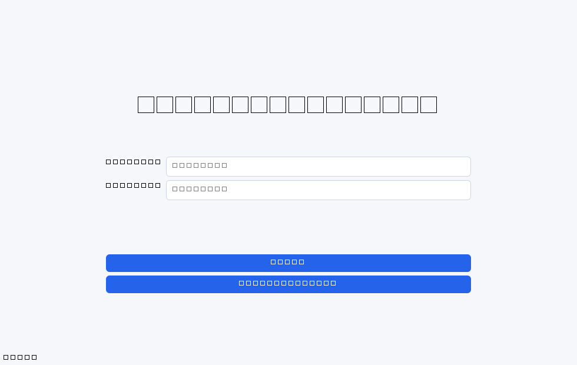

This project has not been written by A.I.
# Project – Python Password Manager

**Project** is a secure, lightweight password manager built with Python. It provides a
PyQt6 desktop interface and an optional command-line interface, with passwords stored
locally in encrypted per-user vault files.

---

## Features

*  **User Authentication** – Sign up and log in with secure credential validation.
*  **Authenticated Encryption** – Passwords are protected with Fernet authenticated encryption.
*  **Password Generator** – Create passwords of custom length and strength (weak, medium, strong).
*  **Per-User Encrypted Storage** – Each user has a separate `.csv` file, encrypted with their own password.
*  **Tabular Display** – View stored credentials in a clean, structured table using `tabulate`.
*  **PyQt6 Desktop UI** – Login, signup, vault search, add, copy, delete, and logout workflows.
*  **Windows EXE** – A standalone packaged application is included for Windows users.

---

## Requirements

Install dependencies:

```bash
pip install cryptography tabulate pytest PyQt6 pyinstaller
```
Alternatively, install everything from `requirements.txt`:

```bash
pip install -r requirements.txt
```


Compatible with **Python 3.10+**.

---

## Getting Started

Clone the repository and run the script:

```bash
git clone https://github.com/MCnima/password-manager.git
cd project
python project.py
```

## PyQt Interface

Launch the graphical interface:

```bash
python project.py
```

The original command-line interface remains available:

```bash
python project.py --cli
```

The interface provides login and signup screens, a searchable password table,
password generation, credential creation, clipboard copying, logout, and
window-close protection that re-encrypts the active vault.



### Windows executable

A standalone release is available at:

```text
dist/PasswordManager.exe
```

No Python installation is required to run the EXE. On first launch, the application
creates `data.csv` in the executable's working directory and creates a local vault
for each new account.

To rebuild the executable:

```bash
python -m pip install -r requirements.txt
python -m PyInstaller --noconfirm --clean --onefile --windowed --name PasswordManager --hidden-import pyqt_gui project.py
```

---

## How It Works

### Authentication

* Credentials are stored as a SHA3-512 hash of `username + password` in `data.csv`.
* The login process validates this hash before allowing access.

### File Structure

```
project/
├── project.py               # Main program
├── pyqt_gui.py              # PyQt6 desktop interface
├── test_project.py          # Encryption exit regression tests
├── media/                   # UI preview media
├── dist/PasswordManager.exe # Standalone Windows executable
├── data.csv                 # Stores hashed login credentials
├── <user1>.csv              # Encrypted, per-user storage file
├── <user2>.csv              # Encrypted, per-user storage file
.
.
.
```

### Encryption

* **Algorithm**: Fernet authenticated encryption (AES and HMAC, via `cryptography.Fernet`)
* **Key Derivation**: PBKDF2-HMAC-SHA256 with 1,500,000 iterations
* **Salt**: Static (for simplicity and lack of options; can be improved for production)

### Password Generation

* **Weak**: Lowercase letters only
* **Medium**: Lowercase letters + digits
* **Strong**: Lowercase + uppercase + digits + symbols

---

## Example

```bash
$ python project.py
Welcome. Use login to access your account or use signup to create a new account (login/signup)
```

After logging in, choose:

* `1. Show saved passwords` with `show`
* `2. Create new password` with `create`

After a successful login, the user's file is decrypted only for the active menu operation.
It is re-encrypted in a `finally` block whenever that operation ends, including normal
completion, invalid input, `ValueError`, `Ctrl+C`, end-of-file input, and unexpected errors.
If decryption fails, the file remains encrypted and the session does not attempt to overwrite it.

---

##  Notes

* If you forget your login password, your encrypted data **cannot** be recovered.
* All data is stored **locally** in the script directory.
* The program currently uses `clear` to clear the console; Windows users can replace it with `cls`.
* A new user's storage file is encrypted immediately, even before the first login.
* The executable and source both use local files; account and vault data are not sent to an external service.
* Never distribute a folder containing `data.csv` or `*.csv` vault files unless they belong to you and must remain private.
* The static key salt is retained for compatibility with existing vaults. A future major release may migrate to unique per-vault salts.

---

## What Changed

### Security and exit handling

The data vault is decrypted only after successful login and is re-encrypted in a `finally`
block before leaving the active session. This protects against normal logout, invalid
input, `ValueError`, `KeyboardInterrupt`, EOF, and unexpected menu exceptions.
Newly created account vaults are encrypted immediately.

### PyQt6 interface

The graphical interface adds:

* Login and account signup screens
* Searchable credential table
* Service name, username, password, and description fields
* Built-in 20-character password generation
* Copy-password and delete-entry actions
* Secure logout and close-window re-encryption
* Compatibility with existing three-column CSV vault records

### Packaging and documentation

The project now supports building a standalone Windows EXE, includes PyInstaller in
its dependencies, and documents both GUI and CLI usage. Regression tests cover
re-encryption after invalid input and interrupts, plus prevention of overwrite after
decryption failure.

---
